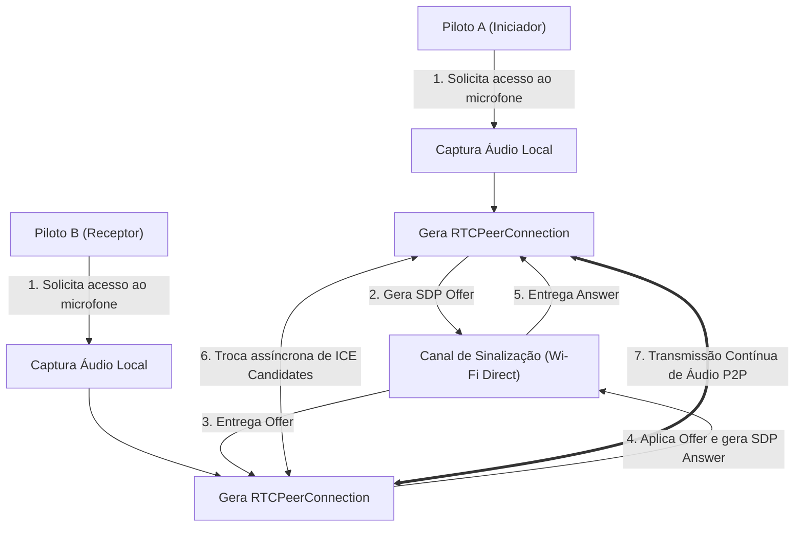

# 🏍️ Moto Intercom

Aplicativo móvel desenvolvido com **React Native** e **Expo** voltado para comunicação por voz em tempo real (intercomunicador) entre motociclistas e garupas/pilotos próximos, operando via **P2P (WebRTC + Wi-Fi Direct)** sem dependência de internet móvel ou servidores centrais de áudio.

---

## 🎯 Destaques do Projeto

- **Comunicação Direta P2P:** Transmissão de áudio bidirecional em tempo real com baixa latência usando `react-native-webrtc`.
- **Independência de Sinal Celular:** Pareamento e descoberta em rede local via Wi-Fi Direct (`react-native-wifi-p2p`).
- **Interface Otimizada para Luvas (Glove-Friendly):** Botões com alvos de toque aumentados (mínimo de 74px de altura), paleta de cores de alto contraste e layout simplificado para fácil acionamento durante a pilotagem.
- **Áudio em Segundo Plano:** Permissões configuradas para que a comunicação continue ativa mesmo com o app minimizado ou com a tela bloqueada.
- **Arquitetura Leve:** Gerenciamento de estado direto e previsível utilizando apenas `useState` do React, sem sobrecarga de bibliotecas externas complexas.

---

## 📁 Estrutura do Código

```text
moto-intercom/
├── android/                   # Projeto nativo Android pré-construído
│   └── app/src/main/
│       └── AndroidManifest.xml # Permissões de Wi-Fi Direct e Background Audio
├── ios/                       # Estrutura nativa iOS
│   └── motointercom/
│       └── Info.plist         # Permissões de Microfone, Rede Local e UIBackgroundModes
├── src/
│   ├── components/
│   │   └── ActionButtons.js   # Botões ergonômicos de alta visibilidade para luvas
│   ├── screens/
│   │   └── HomeScreen.js      # Tela principal do intercomunicador e monitor de status
│   └── services/
│       └── webrtcService.js   # Motor WebRTC (Offer, Answer, ICE Candidates e Streams)
├── App.js                     # Configuração da navegação principal da aplicação
├── app.json                   # Configuração e plugins nativos do Expo
└── package.json               # Dependências do projeto
```

---

## 🔄 Fluxo de Conexão e Funcionamento

O ciclo de conexão entre dois motociclistas segue as seguintes etapas:



1. **Captura do Áudio Local:** Ao pressionar **"INICIAR INTERCOM"**, o aplicativo solicita acesso ao microfone via `mediaDevices.getUserMedia({ audio: true })`.
2. **Criação da Conexão:** É instanciada a `RTCPeerConnection` com servidores ICE/STUN para negociação de rota.
3. **Oferta e Resposta (SDP Handshake):**
   - O dispositivo que inicia a chamada cria uma **SDP Offer** e a envia ao dispositivo parceiro.
   - O receptor recebe a oferta, configura sua descrição remota e devolve uma **SDP Answer**.
4. **Candidatos ICE:** Conforme caminhos de rede são descobertos, os pacotes ICE Candidates são trocados para estabelecer o melhor túnel UDP direto.
5. **Conversação Ativa:** O áudio flui continuamente. O piloto pode mutar/desmutar o microfone rapidamente pelo botão dedicado.

---

## 📋 Pré-requisitos

Antes de iniciar, certifique-se de possuir em seu ambiente de desenvolvimento:

- **Node.js:** Versão LTS recomendada (>= `22.13.0` ou `20.x`).
- **NPM:** `10.x` ou superior.
- **Java Development Kit (JDK):** Versão 17 (padrão do React Native atual).
- **Android Studio:** Com Android SDK e ferramentas de compilação configuradas (`ANDROID_HOME`).
- **Dispositivos de Teste:** É altamente recomendado testar em **dispositivos físicos**, pois o Wi-Fi Direct e as transmissões de microfone do WebRTC dependem de hardware real.

---

## 🚀 Como Rodar o Projeto

### 1. Clonar o repositório e instalar dependências
```bash
git clone <url-do-repositorio>
cd moto-intercom
npm install
```

### 2. Gerar a estrutura nativa (se necessário)
Como o projeto utiliza módulos nativos (`react-native-webrtc` e `react-native-wifi-p2p`), o comando de prebuild garante a ligação de todos os binários:
```bash
npx expo prebuild
```

### 3. Executar no Android (Dispositivo ou Emulador)
Conecte o seu smartphone via USB com a Depuração USB ativada e execute:
```bash
npm run android
```
*Ou usando o CLI do Expo:*
```bash
npx expo run:android
```

### 4. Executar no iOS (Disponível apenas em ambiente macOS)
```bash
npm run ios
```
*Ou:*
```bash
npx expo run:ios
```

---

## 🧪 Como Testar a Aplicação

Para validar o funcionamento correto de ponta a ponta:

### Cenário de Teste 1: Teste com Dois Dispositivos Físicos (Ideal)
1. Instale o aplicativo em **dois aparelhos Android**.
2. Conecte ambos à mesma rede Wi-Fi local ou ative o ponto de acesso Wi-Fi / Wi-Fi Direct entre eles.
3. Abra o app em ambos os aparelhos e conceda as permissões de **Microfone**, **Localização** e **Dispositivos Próximos**.
4. Toque em **"INICIAR INTERCOM"** no primeiro dispositivo. O status mudará para `CONECTANDO...` e em seguida `CONECTADO`.
5. Fale ao microfone e confirme a reprodução do áudio remoto no segundo dispositivo.
6. Teste o botão **"MUTAR MIC"** para verificar se o áudio cessa e o badge `"MICROFONE MUTADO"` é exibido.

### Cenário de Teste 2: Validação de Áudio em Segundo Plano (Background Mode)
1. Com a chamada ativa (`CONECTADO`), minimize o aplicativo ou desligue a tela do celular.
2. Continue falando pelo microfone ou headset do capacete.
3. Certifique-se de que a comunicação de voz permaneça ativa e audível no outro dispositivo.

### Cenário de Teste 3: Teste de Botões com Luvas
1. Vista luvas de motociclista.
2. Verifique se os botões de ação na tela principal possuem área de toque suficiente para clique firme sem acionamentos acidentais.

---

## 🔒 Permissões Nativas Utilizadas

### Android (`AndroidManifest.xml`)
- `RECORD_AUDIO` / `MODIFY_AUDIO_SETTINGS`: Captura e equalização de áudio para intercomunicação.
- `ACCESS_FINE_LOCATION` / `ACCESS_COARSE_LOCATION`: Necessárias no Android para varredura de redes locais e Wi-Fi Direct.
- `ACCESS_WIFI_STATE` / `CHANGE_WIFI_STATE`: Gerenciamento da interface Wi-Fi Direct.
- `NEARBY_WIFI_DEVICES`: Escaneamento de dispositivos P2P no Android 13+.
- `FOREGROUND_SERVICE` / `FOREGROUND_SERVICE_MICROPHONE`: Permite a continuidade do streaming de voz com app em segundo plano.
- `BLUETOOTH` / `BLUETOOTH_CONNECT`: Suporte para fones de ouvido e comunicadores Bluetooth de capacete.

### iOS (`Info.plist`)
- `NSMicrophoneUsageDescription`: Justificativa do uso do microfone para intercomunicação.
- `NSLocalNetworkUsageDescription`: Justificativa de acesso à rede local para descobrir aparelhos parceiros.
- `UIBackgroundModes` com `audio`: Mantém a sessão de áudio viva mesmo com a tela bloqueada.
